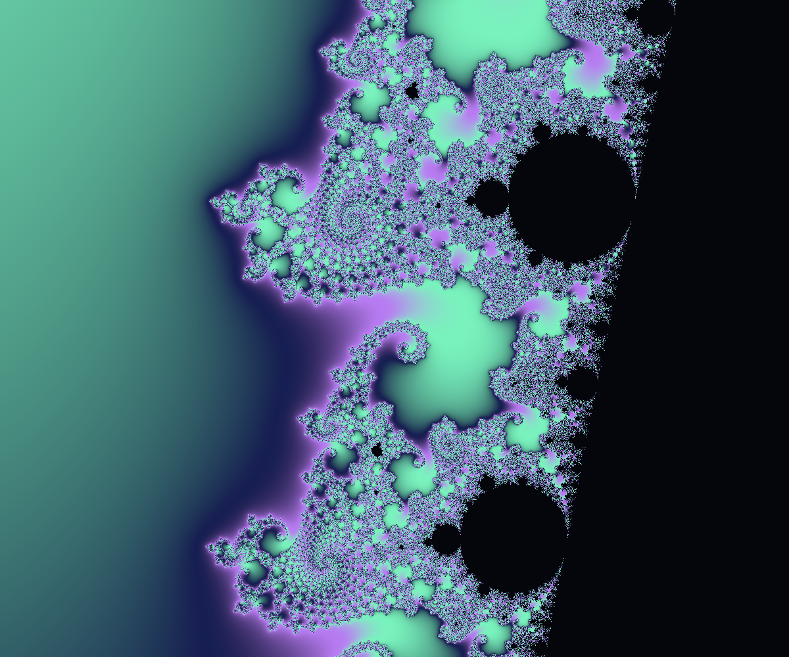
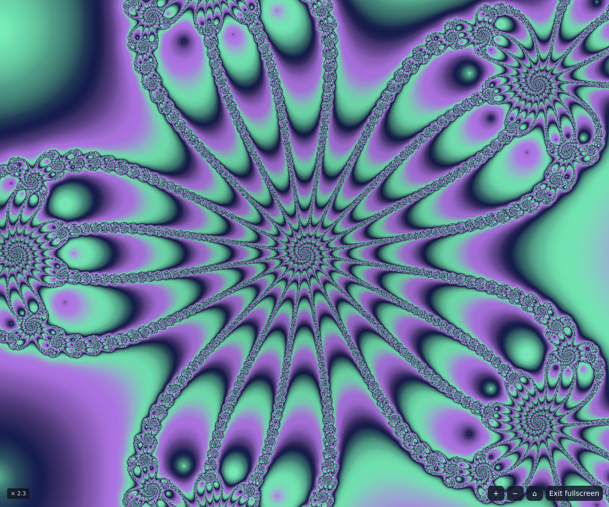

# Fractals

An interactive, browser-based fractal explorer built with HTML, CSS, and JavaScript in a single file. No installation, dependencies, or build step required.

[Open the explorer](https://mwouts.github.io/fractals/)

## Explore

- Explore Mandelbrot and linked Julia sets, Burning Ship, Multibrot (degrees 2–8), Newton basins, and Phoenix fractals.
- Click the parameter plane to update the linked dynamical view. Drag with a mouse or pen to select an area and zoom into it; Shift-drag or touch-drag to pan. You can also scroll or use the +/− buttons to zoom, and use the home button to reset a view.
- Focus a canvas and use the arrow keys to pan, +/− to zoom, or Enter in the parameter plane to select its center.
- Customize palettes, color periods, and iteration limits; browse example scenes or enter full screen.
- Export PNG images at 1920 or 3840 pixels wide, and share either both views or a single view by URL.
- Keep bookmarks and the latest 30 history entries in your browser. Plot descriptions in gallery, notebook, and history cards are selectable for manual copying. Export/import JSON archives to transfer entries between browsers.
- Choose an interface language and follow references to Wikipedia, Wikidata, and Ultra Fractal.

## Screenshots

<a href="https://mwouts.github.io/fractals/#c=-0.745%2C0.186&amp;m=-0.743643887037%2C0.131825904205%2C0.025&amp;j=0%2C0%2C3.6&amp;p=171f52-b77bf1-79f2bd&amp;t=28&amp;i=1024&amp;f=0&amp;family=mandelbrot&amp;degree=3&amp;memory=-0.5&amp;nc=flow&amp;lang=en&amp;view=0"></a>

<a href="https://mwouts.github.io/fractals/#c=0%2C0&amp;m=0%2C0%2C1.6&amp;j=0%2C0%2C1.2&amp;p=171f52-b77bf1-79f2bd&amp;t=24&amp;i=512&amp;f=0&amp;family=newton&amp;degree=5&amp;memory=-0.5&amp;nc=flow&amp;lang=en&amp;view=0"></a>

<a href="https://mwouts.github.io/fractals/#c=0.56667%2C0&amp;m=-0.5%2C0%2C3.6&amp;j=0.35%2C0.7%2C1&amp;p=30134d-ec6440-ffe9ac&amp;t=24&amp;i=1024&amp;f=1&amp;family=phoenix&amp;degree=3&amp;memory=-0.5&amp;nc=flow&amp;lang=en&amp;view=1"></a>

Each screenshot links to its exact interactive view.

## Run locally

From the repository directory:

```sh
python3 -m http.server 8000 --bind 0.0.0.0
```

Open <http://localhost:8000>. In a remote development container, forward port 8000 using your editor's Ports panel. Stop the server with Ctrl+C.

Use a current browser with Canvas 2D, Web Workers, ResizeObserver, IntersectionObserver, and structuredClone support. Fractals render on the CPU in background workers. High iteration limits and 3840-pixel exports can take time, especially on mobile devices.

## Data and sharing

Rendering runs locally. Exploration parameters are encoded in the URL fragment; shared links include the view and palette, not your saved notebook. Bookmarks, history, and language preferences use localStorage and are specific to each browser and origin. Localhost and the hosted site therefore have separate notebooks. Export an archive before clearing browser data or moving to another browser.

Clipboard sharing requires HTTPS or localhost. If copying fails, copy the URL from your address bar. External reference links open third-party sites when clicked.

## GitHub Pages

The deployment workflow at `.github/workflows/pages.yml` publishes `index.html` and `LICENSE` to GitHub Pages on pushes to `main`. It can also be run manually from the Actions tab. No build is needed.

Repository setup: in **Settings → Pages → Build and deployment → Source**, select **GitHub Actions**. The deployment uses the `github-pages` environment and the standard Pages permissions. Inspect the **Deploy to GitHub Pages** workflow in Actions for deployment status.

Site address: <https://mwouts.github.io/fractals/>.

## Development

The interface, styles, translations, URL encoding, and worker renderer are contained in `index.html`. Serve the file locally, edit it, and reload the browser. Shared states use URL fragments, so no server-side routes are required.

## License

[MIT](LICENSE), copyright 2026 Marc Wouts. Mathematical and formula references are linked in the app's credits.
